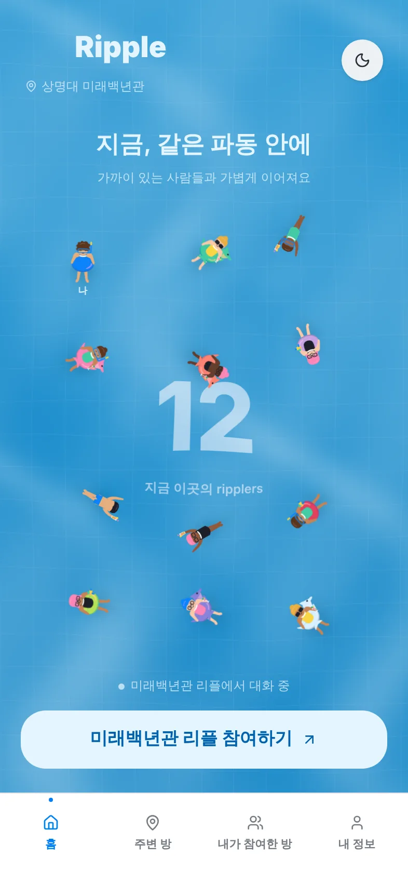
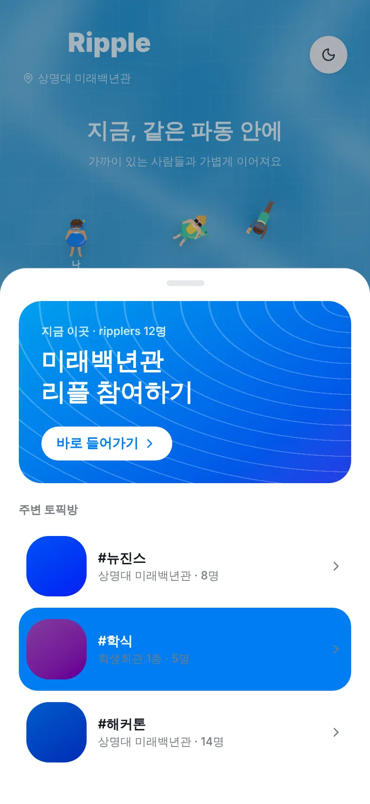
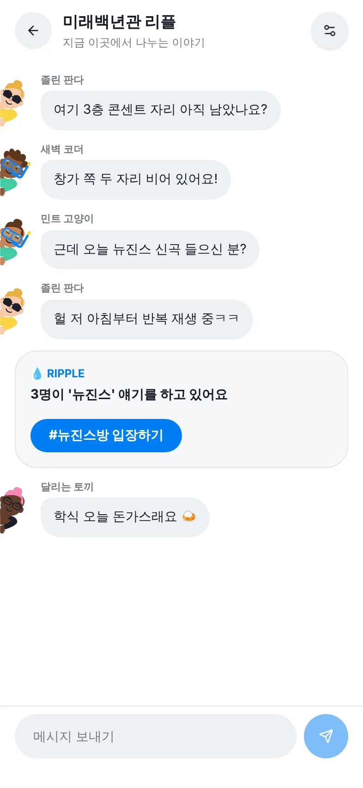
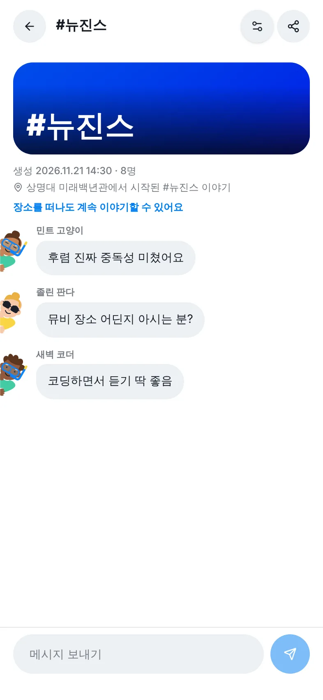
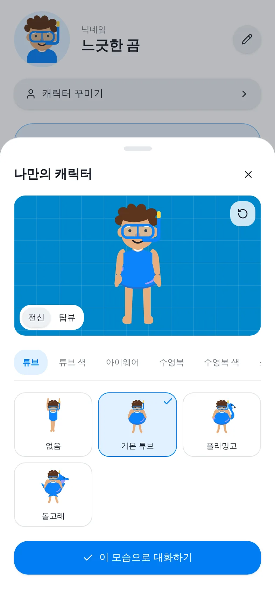

<div align="center">


# 리플 (Ripple)

**친구도, 완전한 익명의 타인도 아닌 — 지금 여기 있는 사람들.**<br>
근처 약 200m 안의 사람들과 닉네임만으로 이야기하는 위치 기반 토픽 라운지 · iOS 클릭형 프로토타입








</div>

## 소개

강의실·도서관·축제 현장처럼 같은 공간에 있지만 말 걸 계기가 없는 사람들을 잇는 앱입니다. 근처 약 200m 안에 있는 사람들을 **ripplers**라 부르고, 장소마다 열리는 라운지에서 대화하다 같은 주제로 이야기하는 사람이 모이면 봇이 `#학식` `#해커톤` 같은 **토픽 방**을 제안합니다. 토픽 방은 장소를 떠나도 이어지기 때문에, 그 자리에서 시작된 대화를 가볍게 계속할 수 있습니다.

이 저장소는 백엔드 없이 목업 데이터로 동작하는 **모바일 우선 클릭형 프로토타입**입니다 (393×852 아이폰 프레임, 데스크톱에서는 가운데 정렬).

## 설계 포인트

| | |
|---|---|
| 위치 신뢰 | 정확한 위치는 근처에 누가 있는지 판단할 때만 쓰고, 약 150m 구역 단위로만 저장하며 다른 사람에게 절대 노출하지 않는다는 원칙을 첫 화면부터 문장으로 약속 |
| 익명성과 책임 | 상대에게는 닉네임만 보이지만, 휴대폰 1회 인증과 고정 사용자 ID에 신고·차단을 연결. 방마다 처음 입장한 닉네임 유지 |
| 닉네임 규칙 | 한글·영문만 허용, 초성·낱자·바코드형 닉네임과 금지어 필터링 |
| 파동(ripple) 화면 언어 | 홈은 ripplers가 튜브를 타고 떠다니는 수영장. 터치하면 그 자리에서 파동이 퍼지고, 화면 전환·테마 변경도 파동으로 표현 |

## 실행

[Bun](https://bun.sh/)을 사용합니다.

```bash
bun install
bun run dev       # 개발 서버
bun run build     # 프로덕션 빌드
bun run test      # Vitest
```

## 구조

```
src/
├─ routes/              TanStack Router 파일 기반 라우트
├─ components/ripple/   리플 화면 (홈 수영장, 라운지, 토픽 방, 내 정보 등)
├─ components/ui/       shadcn/ui 컴포넌트
├─ lib/ · hooks/        유틸리티 · 공용 훅
└─ assets/
```

진행 중인 작업 목록은 [roadmap.md](roadmap.md)에 있습니다.

<details>
<summary><b>초기 기획 프롬프트 (원문)</b></summary>

Build a mobile-first clickable prototype (390x844 iPhone frame, centered on desktop) for an iOS app called "Ripple". Frontend only, mock data, no backend. Single-page app.

Concept: a topic lounge for people in the same place (within ~200m). Not friends, not anonymous strangers: people who are here right now. Users appear only by nickname. People nearby are called "ripplers".

Visual style: Spotify-like and hip. Dark background (#0B0B0F), one vivid accent (electric lime #C6FF3D) plus a soft purple glow, bold large typography (Pretendard or Inter), generous spacing, rounded 24px cards, subtle glassmorphism, smooth micro-animations (framer-motion). All UI text in Korean.

Screens (bottom tab bar: 홈, 지난 방, 내 정보):

1. Location permission intro
   - Title: "지금 여기 있는 사람들과 이어지려면"
   - Body: "정확한 위치는 근처 약 200m 안에 누가 있는지 판단할 때만 써요. 내 위치는 약 150m 크기의 구역으로만 저장되고, 다른 사람에게는 절대 보이지 않아요."
   - Primary button "위치 허용하기", text link "나중에 할게요"
   - Small illustration of water ripples spreading from a single dot

2. Home (radar, inspired by Toss's orbit screen)
   - Center: my avatar emoji with label "나"
   - Concentric rings that feel like water ripples spreading from my avatar (soft fade-out waves every 2 seconds)
   - Blurred anonymous dots floating on the rings (no exact positions)
   - Pill above center: "주변 ripplers 12명" (if fewer than 3, show "주변 ripplers 몇 명")
   - Small chips floating on the rings: recent keyword rooms nearby like "#뉴진스", "#학식", "#해커톤"
   - Huge full-width CTA fixed at the bottom: "지금 여기 사람들과 이야기하기"
   - Secondary pill: "2명 더 모이면 라운지가 열려요" (progress style)

3. Lounge chat
   - Header: "미래백년관 라운지 · ripplers 12명"
   - Chat bubbles with nicknames (e.g. "졸린 판다", "새벽 코더")
   - A highlighted bot card in the middle of the chat: "3명이 '뉴진스' 얘기를 하고 있어요" with a lime button "#뉴진스방 입장하기"
   - Long-press on a message opens a bottom sheet: 신고하기, 차단하기
   - Input bar with send button

4. Keyword room
   - Spotify playlist-style cover card at top: big gradient cover with ripple pattern and "#뉴진스", meta "2026.11.21 14:30 · 상명대 미래백년관 · 8명"
   - Label: "이 방은 장소를 떠나도 유지돼요"
   - Chat below, share button that shows a story-sized room card preview

5. 지난 방
   - Header "이곳의 지난 방"
   - List of room cards with cover gradient, keyword, place, time, member count

6. Phone verification (mock)
   - Phone number input, 6-digit code input, button "인증하고 시작하기"
   - Small note: "상대에게는 닉네임만 보여요"

7. Settings (내 정보 tab)
   - Nickname, blocked users list, report history, contact email "help@ripple.app"

Make transitions between screens smooth. Start on screen 1, then go to Home after tapping 위치 허용하기.

This project was built with [Lovable](https://lovable.dev).

## Build with Lovable

Continue developing this project in the [Lovable editor](https://lovable.dev/projects/998d3af4-ab2c-5b87-90ab-234810db114c).

- **Ship faster**: describe what you want to build and Lovable handles the code.
- **Stay in sync**: every change made in Lovable is committed straight to this repository.
- **Full ownership**: this code is yours. Push to `main` on GitHub and your changes sync back into Lovable, ready for your next prompt.

## Development

Prefer working locally? You need Node.js and npm — [install with nvm](https://github.com/nvm-sh/nvm#installing-and-updating).

```sh
git clone <this-repository-url>
cd <repository-name>
npm i
npm run dev
```

</details>
